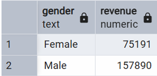
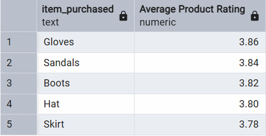
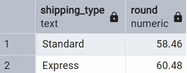
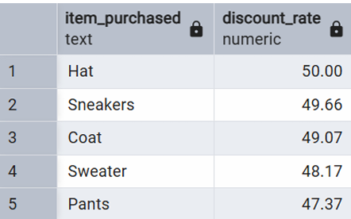
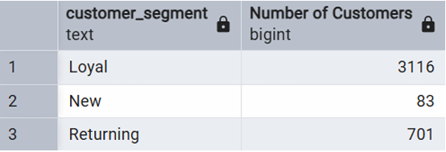
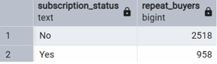
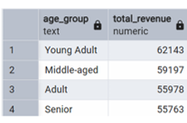
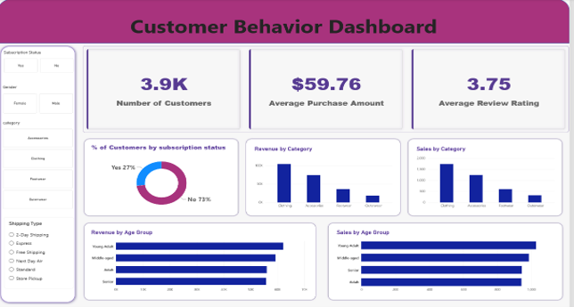

# 📊 Customer Shopping Behavior Analysis

A Data Analytics project using **Python, PostgreSQL, and Power BI** to analyze customer shopping behavior, identify purchasing patterns, and generate actionable business insights.

## 1. 📌 Project Overview

This project analyzes customer shopping behavior using transactional data from **3,900 purchases** across various product categories.

The primary goal is to uncover insights into customer spending patterns, customer segments, product preferences, and subscription behavior to support data-driven business decisions.

The project follows an end-to-end data analytics workflow, starting with data cleaning and preparation in Python, followed by business analysis using PostgreSQL and interactive dashboard development in Power BI.

## 2. Dataset Summary

The dataset contains 3,900 rows and 18 columns.

### Key Features

- **Customer Demographics:** Age, Gender, Location, Subscription Status.
- **Purchase Details:** Item Purchased, Category, Purchase Amount, Season, Size, Color.
- **Shopping Behavior:** Discount Applied, Promo Code Used, Previous Purchases, Frequency of Purchases, Review Rating, Shipping Type.

**Missing Data:** 37 missing values were identified in the Review Rating column.

## 3. Exploratory Data Analysis & Data Cleaning (Python)

Python was used for data exploration, cleaning, and preparation before loading the dataset into PostgreSQL.

### Data Preparation Steps

- **Data Loading:** Imported the dataset using Pandas.
- **Initial Exploration:** Used `df.info()` to understand the dataset structure and `df.describe()` to generate summary statistics.
- **Missing Data Handling:** Identified null values and imputed missing Review Rating values using the median rating of each product category.
- **Column Standardization:** Renamed column names to snake_case for better readability and consistency.
- **Feature Engineering:**
  - Created an `age_group` column by categorizing customer ages into groups.
  - Created a `purchase_frequency_days` column from purchase frequency data.
- **Data Consistency Check:** Checked the relationship between `discount_applied` and `promo_code_used` and dropped the redundant `promo_code_used` column.
- **Database Integration:** Connected Python to PostgreSQL and loaded the cleaned DataFrame into the database for further SQL analysis.

## 4. Data Analysis Using SQL (PostgreSQL)

PostgreSQL was used to perform business-focused analysis and answer key questions related to customer behavior and purchasing trends.

### Business Questions & Analysis

1. **Revenue by Gender:** Compared total revenue generated by male and female customers.
   
   
2. **High-Spending Discount Users:** Identified customers who used discounts but spent more than the average purchase amount.  
3. **Top 5 Products by Rating:** Identified the five products with the highest average review ratings.
  
  
4. **Shipping Type Comparison:** Compared average purchase amounts between Standard and Express shipping.
  

5. **Subscribers vs. Non-Subscribers:** Compared average spending and total revenue across subscription status.
6. **Discount-Dependent Products:** Identified five products with the highest percentage of discounted purchases.
    
7. **Customer Segmentation:** Classified customers into three segments based on purchase history:
   - New
   - Returning
   - Loyal
   
     
8. **Top 3 Products per Category:** Identified the three most purchased products within each product category.
9. **Repeat Buyers & Subscriptions:** Analyzed whether customers with more than five purchases were more likely to subscribe.

    
11. **Revenue by Age Group:** Calculated the total revenue contribution of each customer age group.
    

## 5. Power BI Dashboard

An interactive dashboard was developed using Power BI to visualize the analysis results and present key business insights.

### Dashboard Preview

## 6. Business Recommendations

Based on the analysis, the following business recommendations were identified:

- **Boost Subscriptions:** Promote exclusive benefits and offers to encourage customers to subscribe.
- **Customer Loyalty Programs:** Reward repeat buyers to encourage retention and move them into the Loyal customer segment.
- **Review Discount Policy:** Evaluate discount strategies to balance sales growth with profit margin control.
- **Product Positioning:** Highlight top-rated and best-selling products in marketing campaigns.
- **Targeted Marketing:** Focus marketing efforts on high-revenue customer segments and age groups to improve campaign effectiveness.

## 7. 🛠️ Tools & Technologies

| Tool | Purpose |
|---|---|
| Python | Data cleaning, preparation, and feature engineering |
| Pandas | Data manipulation and analysis |
| PostgreSQL | Database management and SQL analysis |
| SQL | Business analysis and customer segmentation |
| Power BI | Interactive dashboard and data visualization |
| Jupyter Notebook | Python development and analysis |

## 8. 📂 Project Workflow

1. Import and explore the raw dataset using Python.
2. Clean missing values and standardize column names.
3. Perform feature engineering and data consistency checks.
4. Connect Python with PostgreSQL.
5. Load the cleaned dataset into the PostgreSQL database.
6. Execute SQL queries to answer business questions.
7. Build an interactive dashboard using Power BI.
8. Generate actionable business recommendations based on the findings.

## 9. 📊 Key Skills Demonstrated

- Data Cleaning & Data Preprocessing
- Exploratory Data Analysis (EDA)
- Feature Engineering
- Python & Pandas
- SQL Querying & Business Analysis
- PostgreSQL Database Integration
- Customer Segmentation
- Data Visualization
- Power BI Dashboard Development
- Business Intelligence & Data-Driven Decision Making

## 10. Conclusion

This project demonstrates an end-to-end data analytics process, combining Python, PostgreSQL, and Power BI to transform raw transactional data into meaningful business insights.

Through data cleaning, SQL-based analysis, and interactive visualization, the project highlights customer purchasing patterns, subscription behavior, product preferences, and revenue trends that can help businesses make informed strategic decisions.

## 👨‍💻 Author

**Mohammad Tanweer**

B.Tech — Computer Science & Engineering  
Data Analytics Learning Project

---

⭐ This project is part of my journey toward becoming a **Data Analyst**.

**If you found this project useful, feel free to explore the repository and share your feedback!**
